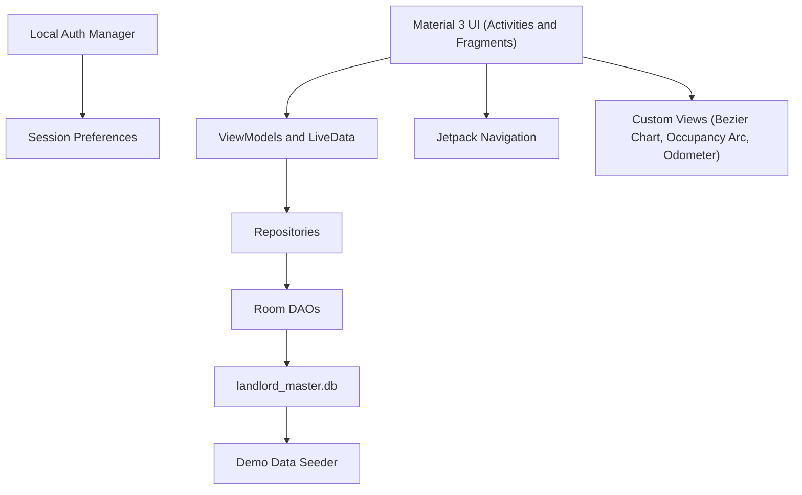

# 🏠 LandLord — Remastered

<p align="center">
  
  
  
  
  
  
  
  
</p>

<p align="center">
  <b>A standalone, offline-first property & tenancy management suite for landlords.</b><br/>
  13 feature modules · Aurora "Fintech Executive" design system · 100% on-device · zero backend required.
</p>

<p align="center">
  <a href="#-getting-started">Getting Started</a> ·
  <a href="#-features">Features</a> ·
  <a href="#-architecture">Architecture</a> ·
  <a href="#-screenshots">Screenshots</a> ·
  <a href="#-contributing">Contributing</a>
</p>

---

## ✨ Highlights

- 🌌 **Fintech Executive aesthetic** — luminous aurora mesh gradients, authentic glassmorphism, neon-glowing bezier charts, rolling odometer tickers, animated occupancy arcs, and pulsing frosted status pills.
- 📴 **Fully offline & standalone** — every CRUD operation mutates a local Room/SQLite database directly. No Retrofit, no sync workers, no network endpoints, no JWT servers.
- 🌱 **Rich demo data on first launch** — 3 properties, 8 units, 5 tenants, agreements, invoices, payments, expenses, maintenance, marketplace leads, conversations, and notifications — instantly alive.
- 🔐 **Dummy local auth** — one-tap Quick Demo Login, custom credentials, persistent session, optional biometric unlock, clean logout.
- 📄 **On-device document engine** — branded multi-page PDF receipts & reports and CSV/XLSX exports via native Android APIs (no cloud).
- 🤖 **Offline AI advisor** — instant portfolio analytics, yield, lease, tax, maintenance, and vacancy guidance.
- 🌓 **Pixel-perfect Day & Night** Material 3 themes with high-contrast semantic tokens.

---

## 📋 Table of Contents

1. [Overview](#-overview)
2. [Features](#-features)
3. [Visual & Motion Design System](#-visual--motion-design-system)
4. [Architecture](#-architecture)
5. [Tech Stack](#-tech-stack)
6. [Modules](#-modules)
7. [Database & Demo Seed](#-database--demo-seed)
8. [Screenshots](#-screenshots)
9. [Getting Started](#-getting-started)
10. [Installation (APK)](#-installation-apk)
11. [Project Structure](#-project-structure)
12. [Key Functional Fixes](#-key-functional-fixes)
13. [Reports & Exports](#-reports--exports)
14. [Authentication & Security](#-authentication--security)
15. [Theming](#-theming)
16. [Configuration](#-configuration)
17. [Contributing](#-contributing)
18. [Roadmap](#-roadmap)
19. [License](#-license)
20. [Acknowledgements](#-acknowledgements)

---

## 🧭 Overview

**LandLord Remastered** is a complete rebuild of a landlord/property-management app into a single, self-contained Android application. The previous Spring Boot / PostgreSQL remote-synchronization architecture (Retrofit outbox queues, `SyncWorker`, network interceptors, JWT auth, OTP endpoints) has been deliberately replaced with a **standalone Room database** so the app is instant, reliable, and demo-ready on any device — with or without connectivity.

It targets landlords managing residential portfolios in urban Bangladesh (Dhaka/Chattogram style data), with BDT (৳) currency formatting, bKash/Nagad/Bank/Cash payment methods, and Bangladeshi tenant profiles (phone, NID).

---

## 🚀 Features

### Core Property Operations
- **Portfolio management** — properties with address, district, area, type, and creation history.
- **Unit roster** — per-property units with rent, status (Vacant/Occupied), apartment type, and configurable utility line charges (Water, Gas, Service Charge).
- **Tenant registry** — profiles with phone, email, national ID, linked units.
- **Lease agreements** — start/end dates, terms, security deposits (e.g. 2 months advance), move-out processing.
- **Monthly billing** — generate period bills with itemized rent + utilities + rolled-over balances; statuses `PAID` / `PARTIAL` / `UNPAID`.
- **Payment recording** — Cash, Bank Transfer, bKash, Nagad; auto-allocation to oldest open invoices; live balance updates.
- **Payment receipts** — branded, on-device PDF receipts with verification badge.
- **Expense tracking** — landlord-borne (generator diesel, lift maintenance, cleaning) and tenant-borne utilities, categorized.
- **Cashbook ledger** — unified chronological income/expense stream with running balance.

### Operations & Engagement
- **Maintenance tickets** — lifecycle `Pending → In Progress → Resolved`, urgency levels, resolution notes.
- **Marketplace & leads** — prospective tenant inquiries with approve/reject workflow.
- **Messaging** — conversation threads with tenants, dynamic IME-aware chat bar.
- **Notifications** — read/unread activity alerts (rent dues, maintenance updates, new leads).
- **Reports** — portfolio financial statements, income & collection, expense breakdown, occupancy/vacancy, tenant statements; PDF + CSV/XLSX export.
- **AI Insights** — offline assistant for yields, rent increases, lease terms, vacancy reduction, maintenance, tax.
- **Settings** — profile, biometric lock toggle, theme switcher, database reset to demo state, logout.

### Real-time Reactivity
Every mutation (payment, expense, ticket, tenant) propagates through `LiveData`/`ViewModel` to dashboards, lists, and KPI cards — no manual reloads.

---

## 🎨 Visual & Motion Design System

The app ships a bespoke **"Fintech Executive"** design language (see `fintech_executive_visual_plan.md`):

| Element | Implementation |
|---|---|
| **Aurora Hero Cards** | Multi-stop midnight obsidian base (`#0A0E17`), indigo/violet diagonal sweep (`#4F46E5`/`#6D28D9`), ambient emerald underglow, 1.5dp specular glass rim. Applied to Dashboard, Payments, Reports, Auth. |
| **Glassmorphism Tiles** | Translucent milky fills (`#18FFFFFF`), dual-tone specular strokes, nested frosted pills, ambient colored underglow. |
| **Glowing Bezier Chart** | Custom `GlowingBezierChartView` — Catmull-Rom cubic splines, translucent vertical area gradient, neon glow via `setShadowLayer`, interactive touch scrubber with floating frosted tooltip + haptic ticks. Zero external chart libs. |
| **Occupancy Arc** | `OccupancyArcView` — 270° sweep gauge with rounded caps, gradient stroke, animated sweep-in, center frosted label. |
| **Odometer Tickers** | `OdometerAnimator` — `ValueAnimator` + `FastOutSlowInInterpolator`, rolling currency/integer/percentage figures across Dashboard & Payments. |
| **Pulsing Status Pills** | `StatusPillHelper` — `SpannableString` with glowing neon beacon dot (`●`) + high-contrast text (>8:1), adapting to light/dark via `@color/color_*_container` tokens. Used across dues, invoices, tenants, maintenance, marketplace, units, dashboard. |
| **Modern Bottom Nav** | Material 3 pill indicator, 80dp expressive height, elevated floating container with surface elevation. |

Color tokens (Indigo `#4F46E5`, Mint Emerald `#10B981`, Rose Coral `#F43F5E`, Amber `#F59E0B`, Cyan `#0EA5E9`) live in `res/values/colors.xml` with full night-mode overrides.

---

## 🏗️ Architecture



**Key principles**
- **Offline-first**: every screen reads/writes Room directly; `LiveData` drives reactive UI.
- **Compile-time SQL safety**: Room verifies queries at build time.
- **No network layer**: removed Retrofit, sync workers, interceptors, JWT/OTP endpoints.
- **Background work**: `AppExecutors` thread pool for non-blocking DB writes.
- **Document generation**: `PdfDocument` + `FileProvider` for on-device PDF/CSV.

---

## 🧰 Tech Stack

| Layer | Technology |
|---|---|
| Language | Java 17 |
| UI | AndroidX AppCompat, Material 3 (`1.12.0`), ConstraintLayout, RecyclerView, SwipeRefreshLayout, CoordinatorLayout |
| Architecture | ViewModel + LiveData (`2.8.7`), Jetpack Navigation (`2.8.5`) |
| Persistence | Room (`2.6.1`) over SQLite, Gson (`2.10.1`) |
| Security | AndroidX Biometric (`1.1.0`), Security-Crypto (`1.1.0-alpha06`) |
| Build | AGP `8.7.2`, Gradle `9.3.0` wrapper, compileSdk/targetSdk `36`, minSdk `26` |
| Documents | `android.graphics.pdf.PdfDocument`, `FileProvider` (no third-party PDF libs) |
| Charting | Pure `android.graphics.Canvas`/`Paint` (no chart library) |

---

## 📦 Modules

| Module | Package | Responsibility |
|---|---|---|
| Dashboard | `feature/dashboard` | KPI grid (occupancy, collected, outstanding, expenses, net, pending maintenance), shortcut tiles, aurora hero, bezier chart, occupancy arc. |
| Properties & Units | `feature/properties` | Portfolio list, property detail, unit roster, add/edit property & unit dialogs. |
| Tenants & Agreements | `feature/tenants` | Tenant list, detail, lease terms, security deposit, move-out. |
| Payments & Invoices | `feature/payments` | Tenant dues overview, payment history, record payment, generate bills, PDF receipts. |
| Expenses | `feature/expenses` | Categorized expenses, totals, log expense dialog. |
| Ledger | `feature/ledger` | Unified cashbook with running balance. |
| Maintenance | `feature/maintenance` | Ticket lifecycle, create/resolve. |
| Marketplace | `feature/marketplace` | Leads/inquiries, approve/reject. |
| Messages | `feature/messages` | Conversations + chat thread, IME-aware input. |
| Notifications | `feature/notifications` | Read/unread activity alerts. |
| Reports | `feature/reports` | 5 report types, filters, PDF/CSV export. |
| Insights (AI) | `feature/insights` | Offline assistant chat. |
| Settings | `feature/settings` | Profile, biometric toggle, theme, DB reset, logout. |
| More | `feature/properties/MoreFragment` | Categorized grid to all modules. |

Navigation graph: `res/navigation/nav_graph.xml` · Bottom nav: `res/menu/bottom_nav_menu.xml`.

---

## 🗄️ Database & Demo Seed

Database: `landlord_master.db` (Room). On first creation, `DatabaseSeeder` populates a cohesive, realistic portfolio:

| Entity | Seed Content |
|---|---|
| Properties (3) | Green View Apartments (Dhanmondi), Sunset Heights (Gulshan-2), Lake Breeze Residency (Uttara) |
| Units (8) | A-101, A-102, B-201, B-202, C-301, C-302, Penthouse, Studio · rents ৳15,000–৳45,000 · 5 occupied / 3 vacant · utility line charges |
| Tenants (5) | Bangladeshi phone (+88017…), email, NID, linked to units |
| Agreements (5) | Active leases with start dates, terms, 2-month security deposits |
| Invoices | Current + 2 prior months · `paid` / `partial` / `unpaid` · itemized utilities + rolled-over balances |
| Payments | bKash, Nagad, Bank Transfer, Cash with transaction IDs & dates |
| Expenses | Landlord-borne (diesel, pump repair, lift, cleaning) + tenant-borne utilities |
| Maintenance (4) | Water leakage (Pending), AC compressor (In Progress), geyser (Resolved), switchboard (Resolved) |
| Marketplace (3) | Applicant inquiries · Pending/Approved |
| Messages (3) | Conversation threads with realistic back-and-forth |
| Notifications | Unread + read rent/maintenance/lead alerts |

**Reset to demo state** anytime from Settings → "Reset Database to Demo State" (clears all tables and re-seeds).

---

## 📸 Screenshots

> Screenshots are coming soon. Drop PNGs into `docs/screenshots/` using these filenames to populate the gallery:

```
docs/screenshots/
├── dashboard.png
├── payments.png
├── reports.png
├── property_detail.png
├── maintenance.png
└── insights.png
```

Once added, the gallery above will be enabled. Contributions with screenshots are welcome.

---

## ⚡ Getting Started

### Prerequisites
- **Android Studio** Hedgehog (2023.1.1) or newer (Ladybug recommended).
- **JDK 17** (project targets Java 17).
- **Android SDK** with platform 36 and build-tools installed (`ANDROID_HOME`/`ANDROID_SDK_ROOT` set).
- **Gradle** — wrapper included (`./gradlew`), no global install needed.
- Device/emulator running **Android 8.0 (API 26)+**.

### Clone & Build
```bash
git clone git@github.com:araf-47/landlord-android-remastered.git
cd landlord-android-remastered

# Verify environment
export ANDROID_HOME=/home/araf/Android/Sdk   # adjust to your SDK path

# Debug build
./gradlew assembleDebug --offline --no-daemon
```
Expected: `BUILD SUCCESSFUL`. APK output: `app/build/outputs/apk/debug/app-debug.apk`.

### Run
Open the project in Android Studio → select a device/emulator → **Run ▶**.

Or install via ADB:
```bash
adb install -r app/build/outputs/apk/debug/app-debug.apk
```

### Release Build
```bash
./gradlew assembleRelease --offline --no-daemon
```
(`minifyEnabled false` by default; configure signing in `app/build.gradle` for distribution.)

---

## 📲 Installation (APK)

A prebuilt debug APK ships in the repo root:

```bash
adb install -r LandLord-Remastered.apk
```
- Size: ~8.9 MB.
- First launch seeds demo data automatically.
- Use **Quick Demo Login** on the auth screen for instant access (no network).

---

## 📁 Project Structure

```
landlord-android-remastered/
├── app/
│   ├── build.gradle
│   └── src/main/
│       ├── AndroidManifest.xml
│       ├── java/com/landlord/android/
│       │   ├── LandlordApp.java
│       │   ├── MainActivity.java
│       │   ├── core/
│       │   │   ├── ai/OfflineAiAssistant.java
│       │   │   ├── auth/ (SessionManager, BiometricLockPrefs)
│       │   │   ├── common/ (PdfReceiptGenerator, PdfReportGenerator, CsvReportGenerator, ReceiptHelper, AppExecutors, Result)
│       │   │   └── db/ (AppDatabase, entities, DAOs, DatabaseSeeder)
│       │   ├── feature/ (dashboard, properties, tenants, payments, expenses, ledger, maintenance, marketplace, messages, notifications, reports, insights, settings, auth)
│       │   └── ui/widgets/ (GlowingBezierChartView, OccupancyArcView, OdometerAnimator, StatusPillHelper, …)
│       └── res/
│           ├── drawable/ (aurora, frosted, pill assets)
│           ├── layout/
│           ├── navigation/nav_graph.xml
│           ├── menu/bottom_nav_menu.xml
│           ├── values/ (colors, strings, themes) + values-night/
│           └── xml/ (file_paths, network_security_config, motion_scene)
├── build.gradle
├── settings.gradle
├── gradle.properties
├── gradlew / gradlew.bat
├── LandLord-Remastered.apk
└── *.md (walkthrough, plans)
```

---

## 🛠️ Key Functional Fixes

1. **Reports calendar** — replaced plain text inputs with native `MaterialDatePicker` dialogs for start/end dates.
2. **PDF cell bounds** — `PdfReportGenerator` enforces column bounding boxes via `canvas.clipRect()`, proportional column weights, and dynamic `fitText` to prevent cell overlap.
3. **Dynamic keyboard insets** — IME insets (`WindowInsetsCompat.Type.ime()`) make the AI & Messages chat bars float above the keyboard; `adjustResize` on `MainActivity`.
4. **Bottom nav visibility** — auto-hides on sub-screens (chat, tenant/property detail, payment history) and restores on top-level tabs.
5. **Payments dues view** — tenant dues overview with live reactive balances and one-tap record payment.
6. **Auth screen cleanup** — removed "Standalone DB"/"100% Offline" badges; subtitle set to "Property & Tenancy Management Suite".
7. **Modern bottom nav** — Material 3 pill indicator, 80dp height, elevated floating container.

---

## 📊 Reports & Exports

Report types (`ReportsFragment` spinner):
1. Portfolio Financial Statement
2. Income & Rent Collection Report
3. Operating Expenses Breakdown
4. Property Occupancy & Vacancy Report
5. Tenant Statement / Ledger

Filters: property, tenant, category, date range (conditionally shown per report type).  
**View** → structured preview card · **PDF** → multi-page styled document via `FileProvider` · **XLSX/CSV** → spreadsheet opened in Sheets/Excel.

---

## 🔐 Authentication & Security

- **Quick Demo Login** — one tap, no network, lands on Dashboard.
- **Custom credentials** — local username/password.
- **Persistent session** — `SessionManager` (SharedPreferences).
- **Biometric unlock** — optional gate on launch via AndroidX Biometric (`BiometricLockPrefs`), WEAK authenticators.
- **Logout** — clears session, returns to `AuthActivity`.
- **File sharing** — `FileProvider` with scoped `cacheDir/receipts/` for PDFs.

---

## 🌓 Theming

- Material 3 day/night themes (`Theme.LandLord`), `values-night/colors.xml` overrides.
- Semantic container tokens (`color_success_container`, etc.) adapt contrast in both modes.
- All status pills use `@color/color_*_container` so boundaries stay delineated on white and dark surfaces.

---

## ⚙️ Configuration

- `local.properties` — set `sdk.dir` to your Android SDK (gitignored).
- `gradle.properties` — AndroidX, Jetifier, compileSdk suppression, JVM args (`-Xmx2048m`).
- `app/build.gradle` — namespace `com.landlord.android`, applicationId `com.landlord.android`, version `1.0.0-remastered`.
- Network security config: `res/xml/network_security_config.xml` (retained from template; app is offline-first).

---

## 🤝 Contributing

Contributions are welcome. Please:

1. Fork the repository and create a feature branch (`git checkout -b feat/your-feature`).
2. Keep changes consistent with the existing package/feature structure and naming.
3. Run the offline build before submitting:
   ```bash
   ./gradlew assembleDebug --offline --no-daemon
   ```
4. Open a pull request with a clear description and screenshots for UI changes.

Coding conventions: Java 17, ViewBinding, Room DAOs, `LiveData`-backed ViewModels, Material 3 components. Avoid introducing network dependencies — the app is intentionally standalone.

---

## 🗺️ Roadmap

- [ ] Cloud sync / multi-device backup (optional, opt-in).
- [ ] Exportable database backup & restore.
- [ ] Push notifications for rent reminders (local alarms).
- [ ] Multi-currency & localization beyond BDT.
- [ ] Unit & instrumented tests.
- [ ] CI workflow for automated builds.

---

## 📄 License

No `LICENSE` file is currently included in this repository. All rights reserved by the author unless otherwise stated. If you intend to reuse this code, please contact the maintainer.

---

## 🙏 Acknowledgements

- [Material Components for Android](https://github.com/material-components/material-components-android) — Material 3.
- [AndroidX Room](https://developer.android.com/training/data-storage/room) — local persistence.
- [Jetpack Navigation](https://developer.android.com/guide/navigation) — in-app navigation.
- Inspired by fintech UI patterns (Apple Card, Revolut, Linear) for the aurora/glassmorphism system.

---

## 📬 Contact

- **Author:** Araf (araf-47)
- **Repository:** https://github.com/araf-47/landlord-android-remastered
- **Issues:** https://github.com/araf-47/landlord-android-remastered/issues

<p align="center">
  <sub>Built with ☕ and a lot of gradient stops. If this project helped you, please ⭐ the repo.</sub>
</p>
