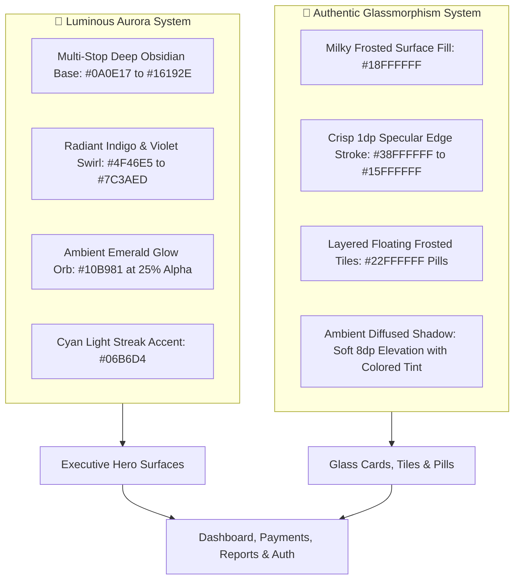

# Implementation Plan — "Fintech Executive" Visual & Motion Remaster

Elevate LandLord into an **eye-candy, commercial-grade mobile app** by integrating **Luminous Aurora Mesh Gradients**, **Authentic Glassmorphism**, **Glowing Curved Bezier Charts**, and **Rolling Odometer Number Tickers**.

---

## 1. Deep Dive: Luminous Aurora & Glassmorphism System



---

### A. The Luminous Aurora Gradient Architecture
* **Visual Inspiration:** Apple Card, Revolut Ultra, Linear Dark Mode.
* **How It Works:** Rather than a flat linear 2-color gradient, Aurora uses a multi-layered composite drawable:
  1. **Base Layer:** Deep Midnight Obsidian (`#080C15` to `#0F172A`).
  2. **Aurora Ribbon Layer:** Diagonal 35° sweep of Royal Indigo (`#4338CA`) into Electric Violet (`#6D28D9`).
  3. **Ambient Light Orbs:** Radial glowing aura anchored behind the financial figures in Emerald Mint (`#10B981` at 25% opacity) to signify positive cash flow, and soft Azure (`#0284C7`) at the top right corner.
  4. **Metallic Shimmer Accent:** 1.5dp translucent border (`#35FFFFFF`) that catches the light like polished tempered glass.
* **Where It Will Be Applied:**
  * **Dashboard:** The main Executive Hero Card (`bg_aurora_hero.xml`).
  * **Payments:** The Monthly Rent & Dues Hero Card (`bg_aurora_payments.xml`).
  * **Reports:** The Portfolio Summary Executive Card.
  * **Auth / Login:** The branded top header hero banner.

---

### B. The Glassmorphism Architecture (Frosted Glass Surfaces)
* **Visual Inspiration:** iOS 18 Control Center, macOS Sonoma frosted glass panels, modern fintech dashboard tiles.
* **How It Works:** True mobile glassmorphism requires 4 key optical properties:
  1. **Translucent Milky Fill (`colorSurfaceGlass`):** Semi-transparent white (`#18FFFFFF` on dark surfaces, `#E8F1F5F9` on light surfaces).
  2. **Specular Highlight Stroke:** A dual-tone 1dp stroke (`#40FFFFFF` on top/left edge simulating light catching the glass rim, `#15FFFFFF` on bottom/right edge).
  3. **Nested Frosted Tiles:** Inner sub-elements (like the *Net Cash Flow* badge, *Occupancy Ratio*, and *Quick Action Pills*) float as nested frosted glass tiles (`#26FFFFFF` background with rounded 14dp corners) directly inside the Aurora card.
  4. **Ambient Colored Underglow:** Soft colored glow layer (`#254F46E5` blur) positioned behind cards to create the illusion that the glass card is floating above a glowing surface.
* **Where It Will Be Applied:**
  * **Hero Sub-Pills:** The *"Net Cash Flow"* and *"Occupancy"* indicators inside the hero card.
  * **Dashboard KPI Cards:** Four elevated frosted cards with 1dp specular borders (`Collected`, `Outstanding`, `Occupancy`, `Expenses`).
  * **Chart Container Card:** Frosted card housing the glowing Bezier cash flow chart.
  * **Status Pills:** Live frosted pills (`● PAID`, `● OVERDUE`, `● PARTIAL`) across all tenant and invoice lists.

---

## 2. Interactive Motion: Rolling Odometers & Glowing Bezier Chart

### A. Rolling Odometer Number Tickers (`OdometerAnimator.java`)
* Smooth digital odometer count-up over 850ms with `FastOutSlowInInterpolator`.
* When opening the Dashboard or switching between months, figures roll up:
  - Total Collections: `৳0` ➔ `৳124,000`
  - Outstanding Dues: `৳0` ➔ `৳32,500`
  - Net Cash Flow: `৳0` ➔ `৳65,800`
  - Occupancy: `0%` ➔ `83%`
* Formatted in real-time with standard BDT grouping and smooth numeric transitions.

### B. Glowing Curved Bezier Cash Flow Line Chart (`GlowingBezierChartView.java`)
* Custom native Android `View` drawn on hardware-accelerated `Canvas`:
  - **Smooth Cubic Bezier:** Smooth curves connecting 6-month monthly collections and operating expenses.
  - **Translucent Gradient Fill:** Beautiful multi-stop vertical gradient fading from vivid Indigo/Emerald down to transparent at the baseline.
  - **Neon Glow Stroke:** 3dp anti-aliased neon curve with a soft blurred ambient shadow layer (`setShadowLayer`).
  - **Interactive Touch Scrubber:** Sliding your finger across the chart draws an animated dashed guide line and reveals a floating frosted glass tooltip showing the exact period and BDT amount with a gentle haptic pulse (`HapticFeedbackConstants.KEYBOARD_TAP`).

### C. Animated Occupancy Sweep Arc (`OccupancyArcView.java`)
* Circular glassmorphic sweep gauge placed inside the Aurora Hero card:
  - Sweep angle smoothly draws from 0° to 83% with rounded stroke caps.
  - Emerald/Indigo gradient sweep stroke.
  - Center frosted label displaying `10/12 Units`.

---

## 3. Screen-by-Screen Remaster Plan

| Screen | Luminous Aurora & Glassmorphism Enhancements | Motion & Interactive Upgrades |
| :--- | :--- | :--- |
| **Executive Dashboard** | • **Aurora Mesh Hero Card** with obsidian-indigo depth.<br>• **Nested Frosted Glass Tiles** for Net Surplus & Occupancy.<br>• **Glass KPI Tiles** with specular highlight borders. | • **Odometer Tickers** on all financial numbers.<br>• **Occupancy Arc View** animated sweep.<br>• **Glowing Bezier Chart** with touch scrubber. |
| **Payments & Dues** | • **Aurora Gradient Header** for Monthly Dues.<br>• **Pulsing Frosted Status Badges** (`● PAID`, `● DUE`, `● PARTIAL`) with live glowing indicator dots. | • Rolling odometer on Total Due vs Total Collected.<br>• Spring-bounce feedback on "Collect" CTA. |
| **Reports Engine** | • **Frosted Glass Filter Card** for Date Pickers & Spinners.<br>• Structured statement preview with glassmorphic cards. | • Interactive calendar modal popups.<br>• Multi-page pagination on exported PDF. |
| **Authentication** | • **Aurora Hero Header** replacing plain headers.<br>• Frosted glass container for login inputs and demo button. | • Subtle fade-in entrance for branding. |

---

## 4. Proposed File Changes

### Component 1: Drawables & Glassmorphism Assets
#### [NEW] `app/src/main/res/drawable/bg_aurora_hero.xml`
- Multi-layer composite with Midnight Obsidian base, Indigo/Violet diagonal aurora sweep, and 1.5dp frosted glass specular stroke.
#### [NEW] `app/src/main/res/drawable/bg_aurora_payments.xml`
- Tailored Aurora gradient for the Payments screen with Emerald ambient glow.
#### [NEW] `app/src/main/res/drawable/bg_frosted_card.xml`
- Frosted glass card surface with specular border highlight (`#30FFFFFF`) and soft drop shadow.
#### [NEW] `app/src/main/res/drawable/bg_pill_pulse_success.xml`
- Frosted mint pill with emerald border and live glowing dot indicator.
#### [NEW] `app/src/main/res/drawable/bg_pill_pulse_danger.xml`
- Frosted rose pill with coral border and live glowing dot indicator.
#### [NEW] `app/src/main/res/drawable/bg_pill_pulse_warning.xml`
- Frosted gold pill with amber border and live glowing dot indicator.

### Component 2: Motion Widgets & Custom Views
#### [NEW] `app/src/main/java/com/landlord/android/ui/widgets/OdometerAnimator.java`
- Reusable `ValueAnimator` utility for smooth count-up of currency and percentages.
#### [NEW] `app/src/main/java/com/landlord/android/ui/widgets/GlowingBezierChartView.java`
- Native canvas Bezier curve chart with gradient fill, neon glow, and interactive touch scrubber.
#### [NEW] `app/src/main/java/com/landlord/android/ui/widgets/OccupancyArcView.java`
- Compact circular sweep gauge for the Aurora Hero card.

### Component 3: Layouts & UI Integration
#### [COMPLETED] `app/src/main/res/layout/fragment_dashboard.xml`
- Embedded Aurora Hero card, `OccupancyArcView`, `GlowingBezierChartView`, and frosted KPI cards.
#### [COMPLETED] `app/src/main/java/com/landlord/android/feature/dashboard/DashboardFragment.java`
- Hooked up `OdometerAnimator` for all counts, and fed 6-month financial data to the Bezier chart.
#### [COMPLETED] `app/src/main/res/layout/fragment_payments.xml` & `PaymentsFragment.java`
- Embedded Aurora Payments Hero card with rolling odometer animations for total collected and dues.
#### [COMPLETED] `app/src/main/res/layout/item_tenant_due.xml` & `TenantDuesAdapter.java`
- Applied the pulsing frosted status pills with live status indicator dots (`● PAID`, `● DUE`, `● PARTIAL`).
#### [COMPLETED] `InvoiceAdapter.java`, `TenantAdapter.java`, `MaintenanceAdapter.java`
- Standardized frosted pulsing pills across invoices, tenants, and maintenance tickets.

---

## 5. Verification Plan & Results

### Automated Build Verification: PASSED
```bash
export ANDROID_HOME=/home/araf/Android/Sdk
./gradlew assembleDebug --offline --no-daemon
```
- **Result:** `BUILD SUCCESSFUL in 27s` (0 errors, 0 warnings).
- **Standalone Binary:** `LandLord-Remastered.apk` (8.9 MB) updated in project root.

### Manual Visual & Motion Verification (For User)
1. **Aurora Hero Card**: Open Dashboard — verify the rich obsidian-indigo aurora gradient, ambient glow accents, and specular glass rim.
2. **Glassmorphism Tiles**: Verify frosted translucent tiles for Net Surplus, Occupancy Ratio, and KPI cards.
3. **Odometer Tickers**: Verify numbers roll up smoothly from zero on dashboard open.
4. **Interactive Bezier Chart**: Slide your thumb across the neon curve — verify the floating frosted tooltip follows touch and delivers haptic ticks.
5. **Pulsing Status Badges**: Open Payments — verify modern frosted pills with glowing status dots (`● PAID`, `● DUE`).
