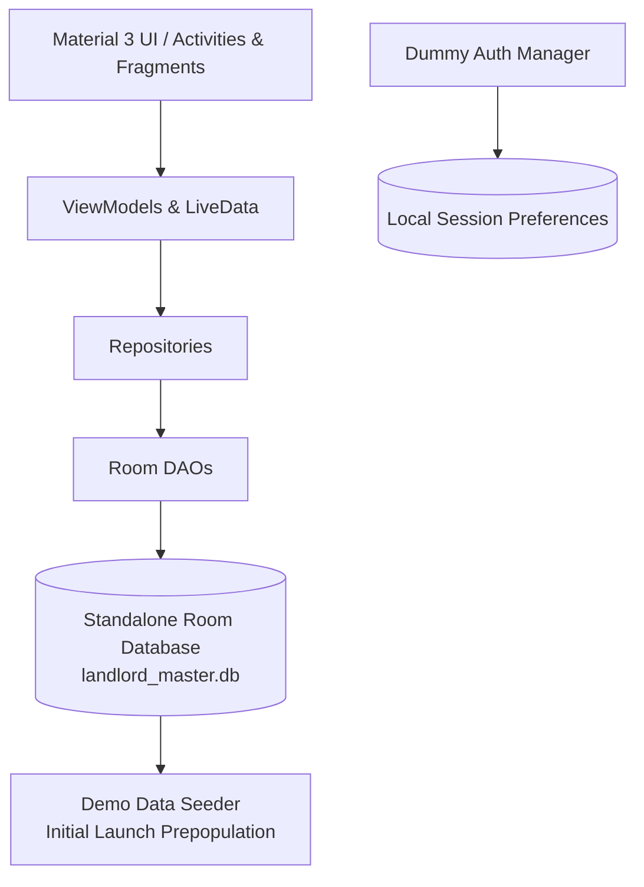

# LandLord Android App Remaster — Implementation Plan

## Goal Description
Recreate and remaster the LandLord Android application into `/home/araf/Working-ground/android-project-remastered-AGY` from the reference projects (`landlord-android`, `LandLord-Angular-Project-R70`, `landlord-backend`). 

### Core Remaster Directives
1. **Standalone Local Database**: Replace the previous Spring Boot / PostgreSQL remote synchronization architecture (which relied on Retrofit outbox queues, `SyncWorker`, and network interceptors) with a fully self-contained local SQLite/Room database. All CRUD operations mutate Room directly with reactive UI updates (`LiveData`).
2. **Pre-Seeded Demo Data**: Pre-populate rich, realistic sample data on first launch (properties in Dhaka/Chattogram, units, active tenants, rental agreements, invoices, payments, expenses, maintenance requests, chat messages, notifications) so the app is instantly functional and alive.
3. **Dummy Authentication**: Streamline authentication into a standalone local auth system (Quick Demo Login / custom local credentials, persistent session, optional biometric unlock, and clean logout) without requiring external JWT servers or OTP network endpoints.
4. **Remastered Feature Parity**: Upgrade all 12 platform modules:
   - **Dashboard**: Replace the minimal profile text with a live KPI card grid (Occupancy rate, Monthly Collected, Outstanding Due, Expenses, Net Revenue, Pending Maintenance) and quick navigation tiles.
   - **Properties & Units**: Property portfolio, unit status tracking (Vacant / Occupied), listing controls, add/edit properties and units.
   - **Tenants & Agreements**: Tenant profiles, national ID, lease terms, security deposits, and move-out processing.
   - **Payments & Invoices**: Generate monthly rent bills, record payments (Cash, Bank, Mobile Banking bKash/Nagad), payment receipts, and payment history.
   - **Expenses**: Property & tenant-borne expense tracking by category.
   - **Ledger**: Real-time cashbook combining income and expense transactions with running balance.
   - **Maintenance**: Ticket lifecycle management (Pending, In Progress, Resolved).
   - **Marketplace & Leads**: Prospective tenant inquiries with approve/reject workflow.
   - **Messages**: Interactive conversation threads with tenants.
   - **Notifications**: In-app notifications with read/unread tracking.
   - **Reports**: Locally generated financial statements and collection analytics.
   - **AI Insights**: Offline intelligent landlord assistant providing portfolio analytics and recommendations.
   - **Settings**: Profile management, biometric lock, theme selection, and database reset to demo state.
5. **Strict Constraint**: Under no circumstances will `/home/araf/git-repo/LandLord-Angular-Project-R70/` or its subdirectories be modified. All development is isolated to `/home/araf/Working-ground/android-project-remastered-AGY`.



---

## Visual & UX Remaster (Stunning Modern Design System)

To give the application an exceptional, modern, and eye-catching appearance, the UI and UX will undergo a complete design uplift:

### 1. Modern Color Palette & Aesthetics
- **Primary Brand Accent**: Premium Electric Indigo / Deep Sapphire (`#4F46E5` & `#6366F1`) paired with sleek dark slate accents (`#0F172A` / `#1E293B`) and crisp snow whites (`#F8FAFC` / `#FFFFFF`).
- **Semantic Punchy Accents**:
  - *Income & Paid*: Vivid Mint Emerald (`#10B981` / `#059669`) with soft tinted background badges (`#ECFDF5`).
  - *Expenses & Overdue*: Warm Rose / Coral (`#F43F5E` / `#E11D48`) with soft tinted background badges (`#FFF1F2`).
  - *Pending & Attention*: Amber / Tangerine (`#F59E0B` / `#D97706`) with warm amber badges (`#FFFBEB`).
  - *Occupancy & Units*: Deep Cyan / Teal (`#0EA5E9` / `#06B6D4`).

### 2. Glassmorphism & Modern Card Styling
- **Hero Header Cards**: Translucent gradient hero banners on the Dashboard, Property Detail, and Tenant Detail screens with subtle border strokes (`#E2E8F0` / `#334155`).
- **Elevated Metric Cards**: 16dp–20dp rounded corner radii, soft drop shadows, tinted circular icon backdrops, large bold numbers, and micro-labels.
- **Pill Badges**: Polished status indicators (e.g., `Occupied`, `Vacant`, `Paid`, `Pending`, `Resolved`) styled as smooth, rounded pill chips with tinted backgrounds and bold text.

### 3. Seamless UX & Micro-Interactions
- **One-Tap Demo Landlord Experience**: Gorgeous login screen featuring a branded hero badge, instant "Quick Demo Login" with prominent primary styling, and direct access.
- **Interactive Bottom Sheets & Dialogs**: Beautiful Material 3 bottom sheets for "Record Payment", "Add Unit", "New Expense", and "Log Maintenance" with clear input field outlines and responsive validation.
- **Real-Time Dynamic Dashboard**: Instant live calculations of total rent collection, outstanding balance, monthly expenses, net cash flow, and occupancy percentages that respond reactively to any changes.
- **Full Day & Night Theme**: Pixel-perfect dark mode styling with deep charcoal and slate surfaces (`#0F172A`), maintaining high contrast and aesthetic polish in low-light environments.

---

## Architecture & Database Selection

### Why Room Database is the Recommended Choice over Raw SQLite
**Room is strongly recommended** for this standalone remastered application:
1. **Room is SQLite under the hood**: Room uses Android's native SQLite engine, so it has all the performance and standalone reliability of SQLite.
2. **Compile-time SQL verification**: Room verifies your SQL queries during build time (`./gradlew assembleDebug`). If there is a typo in a column name or a SQL syntax issue, it fails at compile time rather than crashing during a live demo or runtime.
3. **Reactive UI with LiveData**: Room provides out-of-the-box reactive `LiveData<List<T>>`. Whenever you add a property, record a payment, or resolve a maintenance ticket, all active screens (including the Dashboard KPI cards and list adapters) update automatically without writing manual observer callbacks or reloading logic.
4. **Zero Boilerplate**: Raw SQLite requires manual `SQLiteOpenHelper`, writing hundreds of lines of `cursor.getString()`, `cursor.getInt()`, and `contentValues.put()`, which is error-prone across 12 modules. Room handles this with clean Java annotations (`@Entity`, `@Dao`, `@Query`, `@Insert`).

---

## Rich Demo Seed Data Specification

The database will be initialized completely fresh (clean slate without legacy server fields or sync queue residue), pre-populated with realistic, cohesive dummy data for showcasing and testing:

| Module | Seed Data Content |
|---|---|
| **Properties** | 3 properties: *Green View Apartments* (Dhanmondi, Dhaka), *Sunset Heights* (Gulshan-2, Dhaka), *Lake Breeze Residency* (Uttara, Dhaka). |
| **Units** | 8 units across properties (A-101, A-102, B-201, B-202, C-301, C-302, Penthouse, Studio) with varying rents (৳15,000–৳45,000) and preset utility line charges (Water, Gas, Service Charge). Mix of 5 occupied and 3 vacant. |
| **Tenants** | 5 active tenants with Bangladeshi phone numbers (+88017...), emails, and national IDs (NIDs), paired to units. |
| **Agreements** | 5 active lease agreements with start dates, terms, and security deposits (e.g., 2 months advance). |
| **Invoices** | Multi-month billing history (current month + past 2 months) with realistic statuses: `paid`, `partial`, and `unpaid`, including itemized utility breakdown and rolled-over balances. |
| **Payments** | Realistic payment records across methods (`bKash`, `Nagad`, `Bank Transfer`, `Cash`) with payment transaction IDs and dates. |
| **Expenses** | Landlord-borne (e.g., Generator Diesel, Water Pump Repair, Lift Maintenance, Common Area Cleaning) and tenant-borne utility bills. |
| **Maintenance** | 4 tickets covering different urgency levels: *Water Leakage in Kitchen* (Pending), *AC Compressor Fault* (In Progress), *Bathroom Geyser Repaired* (Resolved), *Electrical Switchboard Fixed* (Resolved). |
| **Marketplace** | 3 applicant inquiries for vacant units with applicant details and status (Pending, Approved). |
| **Messages** | 3 active conversation threads with realistic back-and-forth tenant inquiries and rent payment acknowledgments. |
| **Notifications** | Unread and read alerts for rent dues, maintenance updates, and new marketplace leads. |
| **Reset Option** | A dedicated "Reset Database to Demo State" button in Settings to restore this pristine demo dataset at any time. |

---

## Proposed Changes

The project will be built directly inside `/home/araf/Working-ground/android-project-remastered-AGY`.

### 1. Project Build Configuration & Scaffolding
- [NEW] `settings.gradle`: Configures repositories (Google, MavenCentral) and includes `:app`.
- [NEW] `build.gradle`: Root Gradle script with Android Application Plugin 8.7.2.
- [NEW] `gradle/wrapper/gradle-wrapper.properties` and wrapper JAR (Gradle 9.3.0).
- [NEW] `gradlew` and `gradlew.bat`: Executable scripts for command-line builds.
- [NEW] `app/build.gradle`: Android module config with:
  - compileSdk 36, minSdk 26, targetSdk 36
  - Java 17 compile options
  - ViewBinding enabled
  - Room 2.6.1 + annotationProcessor
  - AndroidX Lifecycle, Navigation, Material 3, Biometrics, Security-Crypto

---

### 2. Standalone Database Layer (`com.landlord.android.core.database`)
- [NEW] `AppDatabase.java`: Primary Room database definition (`landlord_master.db`).
- [NEW] `DatabaseInitializer.java`: Seeds initial portfolio data (Properties, Units, Tenants, Invoices, Payments, Expenses, Maintenance Tickets, Messages, Notifications) on first database creation.
- [NEW] Entities:
  - `PropertyEntity.java`
  - `UnitEntity.java`
  - `TenantEntity.java`
  - `RentalAgreementEntity.java`
  - `InvoiceEntity.java`
  - `PaymentEntity.java`
  - `ExpenseEntity.java`
  - `MaintenanceTicketEntity.java`
  - `MarketplaceRequestEntity.java`
  - `ConversationEntity.java`
  - `MessageEntity.java`
  - `NotificationEntity.java`
- [NEW] DAOs:
  - `PropertyDao.java`, `UnitDao.java`, `TenantDao.java`, `RentalAgreementDao.java`
  - `InvoiceDao.java`, `PaymentDao.java`, `ExpenseDao.java`
  - `MaintenanceTicketDao.java`, `MarketplaceRequestDao.java`
  - `ConversationDao.java`, `MessageDao.java`, `NotificationDao.java`
  - `DashboardStatsDao.java`: Aggregates active occupancy counts, monthly collected totals, outstanding balances, and monthly expense totals.

---

### 3. Authentication & Session (`com.landlord.android.core.auth`)
- [NEW] `AuthManager.java`: Handles local authentication state (logged in / logged out, active landlord profile).
- [NEW] `BiometricLockPrefs.java`: Optional biometric security gate on launch.
- [NEW] `AuthActivity.java`: Login screen with:
  - One-tap "Quick Demo Login" button.
  - Custom username/password login.
  - Informative branding and feature highlights.

---

### 4. Utilities & Generators (`com.landlord.android.core.common`)
- [NEW] `AppExecutors.java`: Background thread pool for non-blocking database writes.
- [NEW] `ReceiptHelper.java`: Generates and shares printable/digital rent payment receipts.
- [NEW] `OfflineAiAssistant.java`: Standalone property management AI providing instant answers on lease regulations, yield calculations, and maintenance advice without external API dependencies.

---

### 5. Application Features & UI (`com.landlord.android.feature`)
- [NEW] **Dashboard (`feature/dashboard`)**:
  - `DashboardFragment.java` & `DashboardViewModel.java`: Live KPI cards (Occupancy, Monthly Collected, Outstanding Due, Expenses, Net Income, Pending Maintenance) and 10 module shortcut cards.
- [NEW] **Properties & Units (`feature/properties`)**:
  - `PropertiesFragment.java`, `PropertiesViewModel.java`: Property listing with units counter and address.
  - `PropertyDetailFragment.java`, `PropertyDetailViewModel.java`: Property details, unit roster, occupancy badge, add-unit dialog.
  - Dialogs: `AddPropertyDialog`, `AddUnitDialog`.
- [NEW] **Tenants (`feature/tenants`)**:
  - `TenantsFragment.java`, `TenantsViewModel.java`: Active tenant list with quick phone/email actions.
  - `TenantDetailFragment.java`, `TenantDetailViewModel.java`: Lease terms, rental agreement details, rent amount, security deposit, and move-out action.
  - Dialogs: `RegisterTenantDialog`, `EditAgreementDialog`.
- [NEW] **Payments & Invoices (`feature/payments`)**:
  - `PaymentsFragment.java`, `PaymentHistoryFragment.java`, `PaymentsViewModel.java`: Invoice roster, payment history, record payment bottom-sheet, generate period bills.
- [NEW] **Expenses (`feature/expenses`)**:
  - `ExpensesFragment.java`, `ExpensesViewModel.java`: Categorized expense list, total expenses summary, log expense dialog.
- [NEW] **Ledger (`feature/ledger`)**:
  - `LedgerFragment.java`, `LedgerViewModel.java`: Unified chronological cashbook combining payments received and expenses incurred with running balance.
- [NEW] **Maintenance (`feature/maintenance`)**:
  - `MaintenanceFragment.java`, `MaintenanceViewModel.java`: Ticket list, status chips (Pending, In Progress, Resolved), create ticket dialog.
- [NEW] **Marketplace (`feature/marketplace`)**:
  - `MarketplaceFragment.java`, `MarketplaceViewModel.java`: Booking/transfer requests, applicant details, approve/reject workflow.
- [NEW] **Messages (`feature/messages`)**:
  - `MessagesFragment.java`, `MessageThreadFragment.java`, `MessagesViewModel.java`: Conversations list and message bubble chat view.
- [NEW] **Notifications (`feature/notifications`)**:
  - `NotificationsFragment.java`, `NotificationsViewModel.java`: System & activity notifications with mark-as-read.
- [NEW] **Reports (`feature/reports`)**:
  - `ReportsFragment.java`, `ReportsViewModel.java`: Monthly financial summaries, tenant dues breakdown, collection efficiency metrics.
- [NEW] **Insights (`feature/insights`)**:
  - `InsightsFragment.java`, `InsightsViewModel.java`: Interactive offline AI assistant chat interface.
- [NEW] **Settings (`feature/settings`)**:
  - `SettingsFragment.java`, `SettingsViewModel.java`: Landlord profile details, biometric unlock toggle, theme switcher, "Reset Database to Demo State", and logout.
- [NEW] **More Navigation (`feature/properties/MoreFragment.java`)**:
  - Categorized grid navigation to all 12 modules.

---

### 6. App Navigation & Resources
- [NEW] `res/navigation/nav_graph.xml`: Full Jetpack Navigation graph linking all 12 modules and detail screens.
- [NEW] `res/menu/bottom_nav_menu.xml`: Bottom navigation (Dashboard, Properties, Tenants, Payments, More).
- [NEW] `res/layout/*.xml`: Material 3 layout files with cards, chips, text inputs, floating action buttons, and empty state views.
- [NEW] `res/values/`: `strings.xml`, `colors.xml`, `themes.xml` (Day & Night M3 theme).

---

## Verification Plan

### Automated Build Verification
1. Run Gradle assemble debug in `/home/araf/Working-ground/android-project-remastered-AGY`:
   ```bash
   ./gradlew assembleDebug --no-daemon
   ```
2. Verify compilation succeeds with zero errors and generates `app/build/outputs/apk/debug/app-debug.apk`.

### Functional Verification
1. **First Launch & Pre-Seeding**: Verify database automatically populates demo properties, units, tenants, invoices, and expenses.
2. **Authentication**: Verify "Quick Demo Login" navigates straight into Dashboard without network calls.
3. **Dashboard Real-Time Metrics**: Verify that creating a new payment or expense immediately updates the Dashboard KPI cards.
4. **CRUD Actions**:
   - Add a new property and unit; verify immediate persistence.
   - Register a tenant and edit lease terms.
   - Record a rent payment and verify invoice balance decreases.
   - Create a maintenance ticket and mark it resolved.
5. **Session & Reset**:
   - Verify biometric lock settings toggle properly.
   - Verify "Reset Database to Demo State" resets data cleanly.
   - Verify logout returns to `AuthActivity`.
