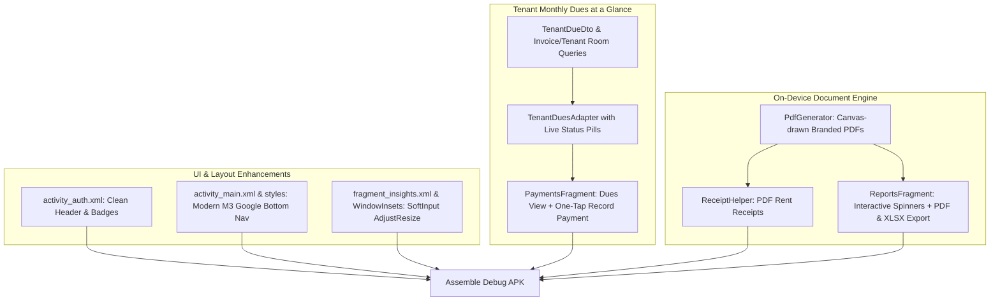

# Implementation Plan — LandLord Remastered UI/UX & Functional Polish

Address all 6 reported issues and feature refinements found during physical device testing:
1. **Login Screen**: Remove the 'Standalone DB' and '100% Offline' badges and modernize the subtitle.
2. **Bottom Navigation**: Redesign the bottom navigation bar to match modern Google apps (Material 3 pill indicators, 80dp expressive height, elevated floating container).
3. **Payments Dashboard**: Redesign the payments screen to showcase **monthly tenant dues at a single glance**, with live reactive balance updates and one-tap payment recording.
4. **Reports Engine**: Fix report selection, wire up report types and filters (Property, Tenant, Category, Date range), render clean structured views, and implement offline on-device **PDF** and **XLSX/CSV** exports.
5. **PDF Payment Receipts**: Upgrade rent receipts from plain text to professional, branded **PDF receipts** generated on-device and openable in any PDF viewer.
6. **AI Insights Keyboard Issue**: Fix window resizing and IME insets so the chat input bar smoothly floats above the keyboard when typing.

---

## User Review Required

> [!IMPORTANT]
> - **PDF & Spreadsheet Generation**: All PDF and CSV/XLSX generation will happen 100% on-device using native Android APIs (`android.graphics.pdf.PdfDocument` and `FileProvider`), without external cloud or network dependencies.
> - **Payment View Transformation**: The Payments tab will now prioritize a **Tenant Dues Overview** (Tenant Name, Unit, Monthly Rent, Total Due, Status Pill, Record Payment CTA) as the primary view, with a toggle/tab to view **Payment History & Receipts**.

---

## Proposed Changes



---

### Component 1: Login Screen Clean-up
#### [MODIFY] `app/src/main/res/layout/activity_auth.xml`
- Remove the "🔒 Standalone DB" and "⚡ 100% Offline" linear layout badges at the bottom.
- Change subtitle from `"Remastered Standalone Edition"` to `"Property & Tenancy Management Suite"`.

---

### Component 2: Modern Google-Style Bottom Navigation Bar
#### [MODIFY] `app/src/main/res/values/themes.xml` & `styles.xml`
- Define Material 3 Navigation Bar style:
  - Height: `80dp`
  - Pill active indicator shape: `ShapeAppearance.Material3.Corner.Full` (pill radius 16dp)
  - Active indicator color: `@color/md_secondary_container`
  - Active item icon tint: `@color/md_on_secondary_container`
  - Active item text: Bold 12sp, `@color/md_primary`
  - Inactive item icon & text tint: `@color/md_on_surface_variant`
#### [MODIFY] `app/src/main/res/layout/activity_main.xml`
- Apply the modern Google M3 style to `BottomNavigationView`.
- Add elevated rounded top border or floating container layout with surface elevation.

---

### Component 3: Payments — Monthly Due of All Tenants at One Glance
#### [NEW] `app/src/main/java/com/landlord/android/feature/payments/TenantDueDto.java`
- POJO data class containing:
  - `tenantId`, `tenantName`, `tenantPhone`, `unitNumber`, `propertyName`, `monthlyRent`, `totalDue`, `latestPeriod`, `paymentStatus` ("PAID", "PARTIAL", "UNPAID").
#### [MODIFY] `app/src/main/java/com/landlord/android/core/db/InvoiceDao.java` & `PaymentRepository.java`
- Add Room query `observeTenantMonthlyDues()` to join active tenants, their units, properties, and open invoice balances.
- In `recordPayment()`, auto-allocate payment to the tenant's oldest open invoice(s) and update invoice balances and statuses from "unpaid" -> "partial" -> "paid".
#### [NEW] `app/src/main/res/layout/item_tenant_due.xml`
- Modern card with:
  - Tenant name, unit & property tag
  - Monthly rent & outstanding due amount (large bold BDT figure)
  - Color-coded status badge (`PAID` green, `PARTIAL` amber, `OVERDUE` red)
  - "Collect Payment" button
#### [NEW] `app/src/main/java/com/landlord/android/feature/payments/TenantDuesAdapter.java`
- RecyclerView adapter displaying tenant dues with one-tap payment callback.
#### [MODIFY] `app/src/main/res/layout/fragment_payments.xml` & `PaymentsFragment.java`
- Add top summary hero card (Total Due, Total Collected This Month, Paid vs Unpaid tenant counts).
- Add Tab/Chip switcher: "Tenant Dues" (default) and "Payment History".
- Clicking "Collect Payment" opens dialog prefilled with the tenant and their remaining due. Submitting immediately updates dues in real time.

---

### Component 4: Reports Section — Interactive Types, PDF & XLSX Exports
#### [MODIFY] `app/src/main/java/com/landlord/android/feature/reports/ReportsFragment.java`
- Populate `input_report_type` spinner:
  1. **Portfolio Financial Statement**
  2. **Income & Rent Collection Report**
  3. **Operating Expenses Breakdown**
  4. **Property Occupancy & Vacancy Report**
  5. **Tenant Statement / Ledger**
- Populate `input_property` and `input_tenant` spinners dynamically from Room database.
- Conditionally show/hide Date Range, Property, and Tenant selectors depending on the selected report type.
- "View" button: renders a clean, structured financial statement preview card.
- "PDF" button: generates an official multi-page styled PDF document and opens it via `FileProvider`.
- "XLSX" button: generates an Excel-compatible CSV spreadsheet and opens it in Google Sheets/Excel.

---

### Component 5: Stunning PDF Payment Receipts
#### [NEW] `app/src/main/java/com/landlord/android/core/common/PdfReceiptGenerator.java`
- Built using Android's native `android.graphics.pdf.PdfDocument`.
- Renders:
  - Indigo/Teal header banner: **LANDLORD PROPERTY MANAGEMENT**
  - **Official Rent Payment Receipt** title
  - Receipt ID, Issue Date, Payment Method (bKash, Nagad, Bank Transfer, Cash)
  - Tenant Details (Name, Phone, Unit #, Property Name)
  - Itemized table (Rent Amount, Utilities, Total Received)
  - Green circular/rectangular **PAID & VERIFIED** badge
  - Authorized signature line & verification footnote
- Saves to `cacheDir/receipts/receipt_<id>.pdf` and shares via `FileProvider` with `Intent.ACTION_VIEW` / `Intent.ACTION_SEND`.
#### [MODIFY] `app/src/main/java/com/landlord/android/feature/payments/PaymentHistoryFragment.java`
- When clicking "Receipt" on any payment, immediately generate and open the stunning PDF receipt!

---

### Component 6: AI Insights Keyboard & Insets Fix
#### [MODIFY] `app/src/main/AndroidManifest.xml`
- Set `android:windowSoftInputMode="adjustResize"` on `MainActivity`.
#### [MODIFY] `app/src/main/java/com/landlord/android/feature/insights/InsightsFragment.java`
- Add `ViewCompat.setOnApplyWindowInsetsListener` to dynamically offset the root layout with IME insets.
- Auto-scroll the chat list when the input field is focused or when the keyboard opens.

---

## Verification Plan

### Automated Build Verification
1. Run Gradle offline build to verify 0 compiler or resource errors:
   ```bash
   export ANDROID_HOME=/home/araf/Android/Sdk
   ./gradlew assembleDebug --offline --no-daemon
   ```
2. Verify updated APK binary in the project root:
   ```bash
   cp app/build/outputs/apk/debug/app-debug.apk LandLord-Remastered.apk
   ls -lh LandLord-Remastered.apk
   ```

### Manual Physical Verification (For User)
1. **Login Screen**: Verify "Standalone DB" and "100% Offline" badges are completely removed.
2. **Bottom Navigation**: Verify Google-style pill selection indicator and modern navigation bar height/feel.
3. **Payments**: Open Payments tab — immediately see all tenants' monthly dues, status pills (PAID / PARTIAL / OVERDUE). Record a payment for a tenant and observe the due balance and status update instantly.
4. **Reports**: Change report type in spinner, select a tenant or property, tap "View" to preview, tap "PDF" to open the generated PDF, tap "XLSX" to open in Sheets/Excel.
5. **Receipts**: In Payment History, tap "Receipt" on any transaction and verify a formatted PDF receipt opens in Google Drive PDF Viewer.
6. **AI Insights**: Tap the question input field — verify the chat box moves up smoothly above the keyboard and the text you are typing remains fully visible.
