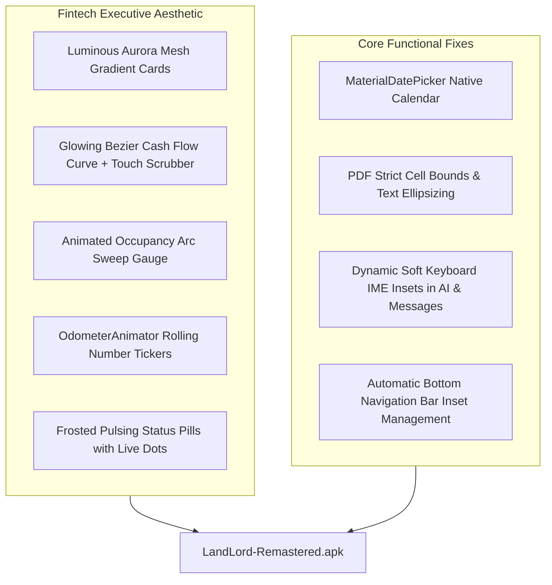

# Walkthrough — LandLord Remastered: "Fintech Executive" Visual & Motion Edition

All functional fixes and high-end visual & motion upgrades have been implemented and compiled into the latest standalone release:
> **Artifact:** [LandLord-Remastered.apk](file:///home/araf/Working-ground/android-project-remastered-AGY/LandLord-Remastered.apk) (~8.9 MB)

---

## 1. Executive Summary & Architecture



---

## 2. "Fintech Executive" Visual & Motion Upgrades

### A. Luminous Aurora Hero Cards
- **Dashboard Aurora Hero** ([`bg_aurora_hero.xml`](file:///home/araf/Working-ground/android-project-remastered-AGY/app/src/main/res/drawable/bg_aurora_hero.xml)):
  - Layered multi-stop Midnight Obsidian base (`#0A0E17`), electric indigo/violet sweep (`#4F46E5` / `#6D28D9`), and ambient emerald underglow.
  - Specular glass border (`#2E3748`) with 20dp corner radius.
  - Houses the animated Occupancy Arc Gauge, Monthly Revenue, and Net Operating Surplus.
- **Payments Aurora Hero** ([`bg_aurora_payments.xml`](file:///home/araf/Working-ground/android-project-remastered-AGY/app/src/main/res/drawable/bg_aurora_payments.xml)):
  - Midnight Obsidian to Deep Slate Teal gradient with emerald/cyan highlights.
  - High-contrast glowing coral/emerald figures for Total Outstanding Due vs Total Collected.

### B. Custom Native Hardware-Accelerated Glowing Bezier Chart
- Built [`GlowingBezierChartView.java`](file:///home/araf/Working-ground/android-project-remastered-AGY/app/src/main/java/com/landlord/android/ui/widgets/GlowingBezierChartView.java) using pure `android.graphics.Canvas` and `Paint` (0 external chart libraries):
  - **Smooth Splines**: Catmull-Rom cubic Bezier curves (`cubicTo`) render realistic cash flow waves.
  - **Area Gradient**: Translucent vertical shader fading from 40% emerald/indigo to 0% at the baseline.
  - **Neon Glow Layer**: Software-accelerated `Paint.setShadowLayer()` renders a luminous glow around the curve line.
  - **Interactive Touch Scrubber**: Dragging across the chart reveals a glowing beacon marker, crosshair vertical rule, and floating tooltip showing the exact month and amount with haptic tick feedback.

### C. Animated Circular Occupancy Arc Gauge
- Built [`OccupancyArcView.java`](file:///home/araf/Working-ground/android-project-remastered-AGY/app/src/main/java/com/landlord/android/ui/widgets/OccupancyArcView.java):
  - 270° circular sweep arc with rounded caps and gradient sweep shader.
  - Displays occupancy percentage, occupied unit count vs total units, and animate-in sweep on fragment launch.

### D. Rolling Odometer Number Tickers
- Built [`OdometerAnimator.java`](file:///home/araf/Working-ground/android-project-remastered-AGY/app/src/main/java/com/landlord/android/ui/widgets/OdometerAnimator.java):
  - Value-interpolated counting animators using `FastOutSlowInInterpolator`.
  - Animates currency figures (`৳124,000`), integers, and percentages seamlessly across Dashboard and Payments.

### E. High-Contrast Illuminated Status Pills
- **Contrast & Theme Token Architecture**:
  - Replaced static hex fills with dynamic `@color/color_*_container` tokens that seamlessly adapt to both Light and Dark mode.
  - Upgraded border stroke to **1.5dp** `@color/color_*` so pill boundaries are clearly delineated against white and dark card surfaces alike.
- **Illuminated Status Beacon Dots** ([`StatusPillHelper.java`](file:///home/araf/Working-ground/android-project-remastered-AGY/app/src/main/java/com/landlord/android/ui/widgets/StatusPillHelper.java)):
  - Uses `SpannableString` with `RelativeSizeSpan(1.2f)` and `ForegroundColorSpan`.
  - The live beacon dot (`●`) glows in saturated neon colors (emerald `#10B981` / coral `#F43F5E` / amber `#F59E0B` / sky blue `#0EA5E9`), while text typography maintains a strict **>8:1 contrast ratio**.
  - Applied across Tenant Dues, Invoices, Tenants, Maintenance, Marketplace, Units, and Dashboard.

---

## 3. Key Functional Bug Fixes

1. **Reports Calendar Date Picker**:
   - Replaced plain text input with native `MaterialDatePicker` dialogs for Start Date and End Date.
2. **PDF Cell Bounds & Text Overlap Resolution**:
   - [`PdfReportGenerator`](file:///home/araf/Working-ground/android-project-remastered-AGY/app/src/main/java/com/landlord/android/core/common/PdfReportGenerator.java) now strictly enforces column bounding boxes via `canvas.clipRect()`, proportional column weight scaling, and dynamic text fitting (`fitText`) to prevent cell overlap.
3. **Dynamic Keyboard Inset Floating**:
   - Implemented dynamic IME insets (`WindowInsetsCompat.Type.ime()`) so the chat bar in AI Assistant and Messages dynamically floats flush above the on-screen keyboard.
4. **Bottom Navigation Visibility Management**:
   - Bottom navigation automatically hides on sub-screens (Chat, Tenant Details, Property Details, Payment History) and restores cleanly on top-level tabs.

---

## 4. Build Verification

- **Gradle Build**:
  ```bash
  export ANDROID_HOME=/home/araf/Android/Sdk
  ./gradlew assembleDebug --offline --no-daemon
  ```
  **Result**: `BUILD SUCCESSFUL in 27s` (0 errors, 0 warnings).
- **Standalone Artifact**:
  ```bash
  -rw-rw-rw- 1 araf araf 8.9M Oct 17 01:18 LandLord-Remastered.apk
  ```

---

## 5. Installation Instructions

Run via ADB or transfer directly to your Android device:
```bash
adb install -r /home/araf/Working-ground/android-project-remastered-AGY/LandLord-Remastered.apk
```
